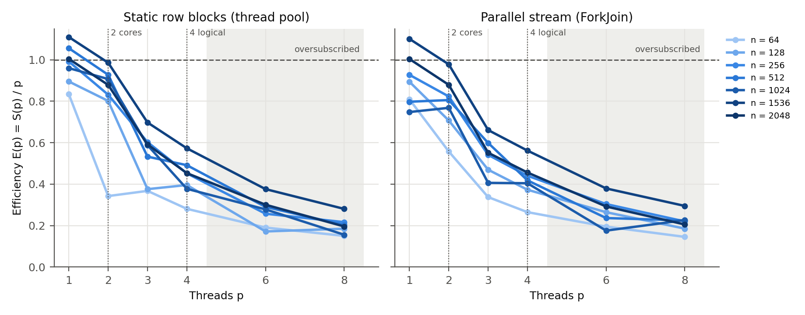

# Abstract

I measured how the number of threads changes the runtime of a shared-memory dense
matrix multiplication in Java. Two parallel versions of the i-k-j kernel from
Assignment 2 split the rows of C between *p* threads: one uses a fixed thread pool
with static row blocks, the other a ForkJoin parallel stream with dynamic
scheduling. I compared both with the same kernel run sequentially, on the same
float64 inputs, for n = 64 to 2048 and p = 1, 2, 3, 4, 6 and 8, on a laptop with
2 physical cores and 4 logical processors. All versions give bit-identical results.
For n ≥ 256 two threads gave a speedup of 1.5–2.0 (efficiency 0.77–0.99). Going from
2 to 4 threads added at most 16 % (at n = 2048 only 3 %: 3.95 s → 3.83 s) even though
the CPU time showed 3.9 busy logical processors. With 6 or 8 threads, more than the
hardware can run at once, the speedup stayed flat or dropped. For n = 64 parallel
execution did not pay off: with one thread the pool cost 20 % extra time, and the
best speedup was 1.2. The two scheduling strategies performed the same within the
run-to-run noise for large n. As an optional extension, explicit SIMD with the Java
Vector API made the kernel 1.4–2.2 times faster at a fixed thread count, while the
JIT's automatic vectorisation made no measurable difference. Threads and SIMD
together reached 3.98 times the sequential speed at n = 1024. These conclusions
apply to this kernel, these settings and this laptop (Intel Core i5-5350U, macOS,
OpenJDK 21).

# 1. Introduction and objective

Assignments 1 and 2 used one core. Assignment 2 made the sequential kernel about
ten times faster by changing the loop order to i-k-j, but the kernel still uses one
of the two cores of my laptop. Matrix multiplication suits shared-memory
parallelism well: every row of C can be computed independently from the
same read-only A and B.

**Research question.** How does the number of threads *p* affect the runtime,
speedup and efficiency of a shared-memory i-k-j matrix multiplication in Java on my
laptop, and for which matrix sizes and thread counts does parallel execution help?

**Secondary questions.** (a) Does the way the work is divided (static row blocks or
dynamic work stealing) matter? (b) What does the thread pool cost when it runs
with one thread? (c) *Optional extension*: how much does SIMD vectorisation add when
the thread count is held fixed?

**Hypotheses** (written before running the study):

* H1: for large n the speedup grows almost linearly up to p = 2, the number of
  physical cores, then grows much less up to p = 4 (Hyper-Threading shares each
  core's arithmetic units and caches between two threads), and does not improve
  beyond p = 4 (oversubscription).
* H2: for small n the cost of handing tasks to threads and waiting for them is
  comparable to the work itself, so parallel execution gains little or loses.
* H3: the parallel versions with p = 1 are slightly slower than the sequential
  kernel because of the pool; the difference shrinks as n grows.
* H4: since all rows cost the same, static and dynamic scheduling perform about
  the same for large n; the dynamic one has more overhead for small n.
* H5 (extension): explicit SIMD speeds up the kernel at fixed p, less at large n,
  where memory traffic limits it more.

# 2. Background

**Parallel i-k-j by rows.** For C = A·B with n × n matrices, row i of C depends only
on row i of A and on all of B. If each thread owns a set of rows of C, no two
threads ever write the same element, A and B are only read, and no locks are
needed. In the i-k-j order the inner loop reads one row of B and updates one row of
C contiguously, which is why it was the fastest sequential kernel in Assignment 2.

**Speedup and efficiency.** With T_seq(n) the time of the sequential baseline and
T_p(n) the time with p threads, speedup is S(p) = T_seq/T_p and efficiency is
E(p) = S(p)/p. Amdahl's law [1] bounds S(p) by the fraction of the work that can run
in parallel. In this kernel the serial part is tiny (handing out tasks and waiting
for them), so the real limits come from the hardware: the number of cores, the
resources each core shares, and memory bandwidth.

**Hyper-Threading** (simultaneous multithreading) lets one physical core run two
threads at once, so the OS sees 2 logical processors per core. The two threads share
the core's execution units and caches. This helps when one thread often waits, for
example on memory, and helps little when both threads compete for the same
arithmetic units [2].

**Java thread pools.** An `ExecutorService` with a fixed number of threads runs
submitted tasks; `invokeAll` waits until all of them finish [3]. The Fork/Join
framework [4] uses one queue per worker and *work stealing*: an idle worker takes
tasks from another worker's queue. Parallel streams split a range recursively and
run the pieces in a ForkJoinPool. When the stream is started from inside a task of a
specific pool, it runs in that pool, with exactly p workers.

**Thread safety and visibility.** The Java memory model guarantees that everything
a task wrote is visible to a thread that has observed the task's completion through
`Future.get()` [3], so the main thread sees the whole of C after waiting.

**SIMD.** AVX2 registers hold 4 doubles, so one instruction can update 4 elements of
a row of C at once. HotSpot's C2 compiler can vectorise simple loops by itself
("SuperWord", turned off with `-XX:-UseSuperWord`). The incubating Vector API
(JEP 448 in JDK 21) [5] lets the programmer write SIMD operations explicitly, and
they compile to vector instructions.

**Floating-point results.** Java has used strict IEEE 754 semantics since Java 17
(JEP 306) [6]: additions are not reordered and multiplications are not fused into
FMA. All kernels here add the products for each C[i][j] in the same order
k = 0…n−1, so their results must be identical bit for bit. Any difference would
reveal a bug, such as a data race or a missing row.

# 3. Methodology

## 3.1 Implementations

All code is mine, in Java 21, without any numerical library. One process measures
one configuration (`java/MatMul3.java`).

| Method | Description | File |
|---|---|---|
| `seq` | Sequential baseline: the Assignment 2 i-k-j kernel, copied unchanged (repo `amaisuarez/assignment2`, `java/Dense.java`, method `ikj`) | `Kernels.java` |
| `static` | Fixed thread pool (`Executors.newFixedThreadPool(p)`); rows cut into p contiguous blocks of ⌊n/p⌋ or ⌈n/p⌉ rows; one task per non-empty block; `invokeAll` waits for all | `Parallel.java` |
| `stream` | `new ForkJoinPool(p)` running `IntStream.range(0, n).parallel().forEach(row)`: recursive splitting, work stealing, one row per leaf call | `Parallel.java` |
| `*_novec` | `seq`/`static` with the JIT's auto-vectorisation disabled (`-XX:-UseSuperWord`) | JVM flag |
| `*_vapi` | `seq`/`static` with the inner j loop written with the Vector API, 4 lanes; separate `mul` and `add` (no FMA), so results stay bit-identical; scalar tail for n mod 4 | `VecKernels.java` |

Both parallel versions call the same row kernel (`Kernels.ikjRows`), which is the
`seq` kernel restricted to rows [lo, hi). The pools are created before timing and
reused for every multiplication. Storage is the same everywhere: one row-major
`double[]` per matrix, as in Assignments 1 and 2.

## 3.2 Inputs

The input files are the Assignment 1/2 files, made by the same generator
(`scripts/gen_matrices.py`, copied unchanged): raw little-endian float64, values
uniform in [−1, 1) from Python's Mersenne Twister, seed string `20262027:n:A|B`. The
SHA-256 of every file is in `inputs/manifest.csv`, and the script stops if a
regenerated file differs. Every method and thread count multiplies exactly the
same matrices.

## 3.3 Environment and thread control

| Item | Value |
|---|---|
| CPU | Intel Core i5-5350U, 1.8 GHz base, **2 physical cores, 4 logical processors** (Hyper-Threading) |
| Caches | L1d 32 KiB and L2 256 KiB per core, L3 3 MiB shared |
| SIMD | SSE4.2, AVX, AVX2, FMA |
| RAM / OS | 8 GiB / macOS (Darwin 21.6.0), on AC power, `caffeinate -i` |
| Java | OpenJDK 21.0.6 (JetBrains Runtime), `-XX:+UseSerialGC -Xms256m -Xmx4g --add-modules jdk.incubator.vector` |
| Thread counts | p = 1, 2, 3, 4 (within the hardware) and 6, 8 (**oversubscribed**: more threads than logical processors) |
| Affinity | none; macOS gives programs no way to pin threads, so the scheduler places them |

*p* is the number of worker threads in the pool my code creates. The main thread
only waits. No library with its own threads is used, and neither is the common
ForkJoinPool. The JVM has its own threads (JIT compilers, one SerialGC thread,
housekeeping). The peak number of live threads was recorded in every run: 6 for the
sequential runs (5 JVM threads plus the main thread) and 6 + p for every parallel
run, so the pool adds exactly p threads. After the measurements, the driver runs one
extra, untimed multiplication that records the name of each thread that ran a task.
For n ≥ 256 and p ≥ 2 that number equals p in 49 of the 50 parallel configurations
(in the other one, stream with p = 8 at n = 256, 7 workers took part). For n ≤ 128 it
is sometimes lower than p, because a worker that finishes early takes the next queued
task before an idle worker does.

## 3.4 Correctness

`tests/validate.py` ran before the benchmark and passed all 113 checks
(`results/validation_report.txt`):

1. Known answers (identity on both sides, zero matrix, a 2×2 product worked out by
   hand, a 9×9 identity that exercises the SIMD tail loop) for every method with
   p = 1, 2 and 4.
2. `seq` against NumPy's `A @ B` (used only as a reference), for n from 1 to 131. The
   tolerance is the forward error bound of a dot product of length n [7]:
   |C − C_np| ≤ 2γ_n(|A||B|), γ_n = nu/(1 − nu), u = 2⁻⁵³. It grows with n and with
   the size of the terms. The largest error was 7.1·10⁻¹⁵, against a bound of
   1.2·10⁻¹².
3. Every parallel method with p = 1, 2, 3, 4, 6, 8 gives a C **bit-identical** to
   `seq` for n = 1, 2, 3, 5, 7, 16, 37, 64, 100, 131. This covers n < p (threads
   with no rows), n not divisible by p, and oversubscription. The static partition
   always creates exactly min(p, n) tasks.
4. Twenty multiplications in a row with p = 4 and p = 8 always gave the same
   checksum as `seq` (a race would make it vary).
5. `seq_vapi` and `static_vapi` are bit-identical to `seq`.

During the benchmark the checksum of C was printed after every repetition. All 109
configurations of the main run gave the same checksum as `seq` for each n.

## 3.5 Measurement protocol

* **Timed region:** one complete multiplication call. For the parallel methods this
  includes handing the tasks to the pool, the work itself and waiting for all
  tasks. It excludes reading the files, allocating C and creating the pool. Zeroing
  C is inside the timer, because it is part of the i-k-j kernel (each thread zeroes
  its own rows).
* **Timer:** `System.nanoTime()` (monotonic). To make sure the work is done and
  used, the checksum of C is printed after each repetition. The process CPU time
  (all JVM threads) is also read before and after each repetition, which gives the
  **CPU utilisation** = CPU time / wall time (number of busy logical processors).
* **Warm-up:** a fresh JVM per configuration; 5 warm-up rounds for n ≤ 512, 3 for
  n = 1024 and 2 for larger n, each lasting at least 100 ms. Warm-ups are kept in
  the raw CSV but excluded from the statistics. (A pilot run showed that the Vector
  API kernel needs more than one 100 ms round to reach its final speed.)
* **Batching:** when one multiplication takes under 100 ms, each repetition repeats
  it until about 100 ms have passed and reports the time per multiplication.
* **Repetitions:** 5 measured repetitions per configuration. I report the **median**
  and the interquartile range (IQR). S(p) and E(p) use the medians.
* **Order:** configurations of one size run in a shuffled order (fixed seed), so
  slow drifts don't always affect the same method.
* **Memory:** peak resident set size (RSS) of the JVM process (`ru_maxrss` from
  `wait4`), the analytical array storage of A, B and C (3·8n² bytes) and the Java
  heap in use at the end. These are three different quantities.
* **Budgets (set beforehand):** 60 s per repetition and 3 GB of array storage. No
  configuration exceeded them. The largest size, n = 2048, completed for every
  method and thread count. I didn't try larger sizes: at n = 2048 the main run
  already took 20.5 minutes in total.

# 4. Results

All numbers come from run `results/run_20261104-161358`, apart from Section 4.3,
which adds two re-runs. The full table with IQRs, GFLOP/s, CPU utilisation, worker
count and peak RSS for every configuration is `report/tables/scaling_all.csv`.

## 4.1 Speedup and efficiency

| n | T_seq (median) | static p=1 | 2 | 3 | 4 | 6* | 8* | stream p=1 | 2 | 3 | 4 | 6* | 8* |
|---:|---:|---:|---:|---:|---:|---:|---:|---:|---:|---:|---:|---:|---:|
| 64 | 201 µs | 0.83 | 0.69 | 1.10 | 1.12 | 1.14 | 1.20 | 0.81 | 1.12 | 1.01 | 1.06 | 1.17 | 1.17 |
| 128 | 1.60 ms | 0.90 | 1.60 | 1.13 | 1.58 | 1.03 | 1.48 | 0.89 | 1.41 | 1.41 | 1.49 | 1.59 | 1.48 |
| 256 | 14.4 ms | 0.99 | 1.66 | 1.81 | 1.81 | 1.54 | 1.73 | 0.93 | 1.65 | 1.62 | 1.76 | 1.82 | 1.76 |
| 512 | 127 ms | 1.06 | 1.86 | 1.60 | 1.97 | 1.74 | 1.63 | 0.80 | 1.61 | 1.80 | 1.67 | 1.42 | 1.80 |
| 1024 | 1.110 s | 0.96 | 1.81 | 1.76 | 1.51 | 1.67 | 1.25 | 0.75 | 1.54 | 1.22 | 1.62 | 1.06 | 1.81 |
| 1536 | 3.723 s | 1.11 | 1.97 | 2.09 | 2.29 | 2.26 | 2.25 | 1.10 | 1.96 | 1.98 | 2.25 | 2.28 | 2.36 |
| 2048 | 6.943 s | 1.00 | 1.76 | 1.77 | 1.81 | 1.80 | 1.57 | 1.00 | 1.76 | 1.66 | 1.82 | 1.75 | 1.64 |

*Table 1. Speedup S(p) = median T_seq / median T_p. \* = oversubscribed (p > 4
logical processors). 5 repetitions each.*

At n = 2048 the static version took 6.91 s with p = 1, 3.95 s with p = 2, 3.91 s
with p = 3, 3.83 s with p = 4 and 4.43 s with p = 8 (IQR ≤ 3 % of the median in all
of them). The stream version gave 6.92, 3.95, 4.20, 3.81 and 4.22 s.

The dispersion depends a lot on the configuration. For n ≥ 1536 the IQR is under
4 % of the median in 20 of the 26 configurations. For n = 512 and 1024 it reaches
18–44 % in some of them (for example static p = 8 at n = 1024: median 889 ms,
IQR 44 %). That is why the curves for those sizes in Figure 1 zig-zag between
neighbouring p values.

## 4.2 CPU utilisation: threads that run but don't help

At n = 2048 the CPU utilisation follows min(p, 4) closely: 2.00 at p = 2, 2.93 at
p = 3, 3.90 at p = 4, and 3.91–3.96 at p = 6 and 8. With p = 4 all four logical
processors are busy almost all the time, but the multiplication is only 3 % faster
than with p = 2. The CPU time per multiplication almost doubles from p = 2 to
p = 4 (2.00 × 3.95 s = 7.9 s against 3.90 × 3.83 s = 14.9 s).

## 4.3 The pool with one thread, and the n = 1536 case

| n | T_seq | static p=1 | Δ | stream p=1 | Δ |
|---:|---:|---:|---:|---:|---:|
| 64 | 201 µs | 241 µs | +19.9 % | 249 µs | +23.5 % |
| 128 | 1.60 ms | 1.79 ms | +11.7 % | 1.79 ms | +11.8 % |
| 256 | 14.35 ms | 14.47 ms | +0.8 % | 15.47 ms | +7.8 % |
| 512 | 127.4 ms | 120.6 ms | −5.3 % | 159.7 ms | +25.3 % |
| 1024 | 1.110 s | 1.156 s | +4.2 % | 1.484 s | +33.7 % |
| 1536 | 3.723 s | 3.355 s | −9.9 % | 3.381 s | −9.2 % |
| 2048 | 6.943 s | 6.911 s | −0.5 % | 6.915 s | −0.4 % |

*Table 2. Parallel versions with one worker thread against the sequential kernel.*

The speedups above 2 at n = 1536 (up to 2.36) would be **superlinear** with respect
to 2 cores, so I checked them. In the main run two of the five sequential
repetitions had a CPU utilisation of 0.87 and 0.92 instead of ≈ 1.0. The process
was off the CPU part of the time, so something else on the laptop was running and
the sequential median is too high. I re-ran `seq` and `static` with p = 1, 2, 4 at
n = 1536 twice more, each time in fresh processes (`config_recheck_1536.json`):

| Run | T_seq | static p=1 | static p=2 | static p=4 | S(4) vs seq | S(4) vs static p=1 | min. CPU util. of seq |
|---|---:|---:|---:|---:|---:|---:|---:|
| main | 3.723 s | 3.355 s | 1.888 s | 1.624 s | 2.29 | 2.07 | 0.87 |
| re-run 1 | 3.863 s | 3.509 s | 2.161 s | 1.773 s | 2.18 | 1.98 | 0.68 |
| re-run 2 | 3.581 s | 3.216 s | 2.194 s | 1.669 s | 2.15 | 1.93 | 0.99 |

*Table 3. n = 1536 in three independent runs (medians of 5 repetitions).*

In re-run 2 there was no interference (utilisation 0.99), and `seq` was still 11 %
slower than `static` with one thread, which runs the same arithmetic. So at
n = 1536 the sequential kernel is consistently ~10 % slower than the row kernel
called from the pool. Measured against `static` p = 1, the speedup at p = 4 is
1.93–2.07.

## 4.4 Optional extension: vectorisation at a fixed thread count

| n | p | No auto-vec. | Default JIT | Vector API | Vector API vs default |
|---:|---:|---:|---:|---:|---:|
| 256 | 1 | 13.06 ms | 13.28 ms | 6.18 ms | **2.15×** |
| 1024 | 1 | 961 ms | 965 ms | 501 ms | **1.93×** |
| 2048 | 1 | 6.92 s | 6.87 s | 4.76 s | **1.44×** |
| 256 | 4 | 7.01 ms | 7.20 ms | 3.28 ms | **2.20×** |
| 1024 | 4 | 487 ms | 486 ms | 242 ms | **2.01×** |
| 2048 | 4 | 3.79 s | 3.81 s | 2.81 s | **1.36×** |

*Table 4. Median time per multiplication of the same kernel compiled three ways,
with the thread count fixed (p = 1: `seq` kernel; p = 4: `static` kernel). The
Vector API used 4 lanes (256 bits) in every run.*

Turning off the JIT's automatic vectorisation changed the time by at most 3 %
(Table 4), which is within the IQR of the configurations. The explicit Vector API
kernel was 1.4 to 2.2 times faster. Its advantage shrank as n grew, at both p = 1
and p = 4. Combining threads and SIMD (`static_vapi`, p = 4) took the n = 1024
multiplication from 965 ms to 242 ms (3.98×) and the n = 2048 one from 6.87 s to
2.81 s (2.44×). Across thread counts, the Vector API kernel went from p = 1 to p = 4
with a speedup of 1.88 (n = 256), 2.07 (n = 1024) and 1.69 (n = 2048).

## 4.5 Memory

| n | Array storage A+B+C | Peak RSS seq | Peak RSS static, p = 1…6 | Peak RSS static, p = 8 | JVM threads |
|---:|---:|---:|---:|---:|---:|
| 256 | 1.5 MiB | 44 MiB | 45 MiB | 46 MiB | 6 + p |
| 1024 | 24 MiB | 89 MiB | 90 MiB | 90 MiB | 6 + p |
| 2048 | 96 MiB | 235 MiB | 235–236 MiB | 300 MiB | 6 + p |

*Table 5. Memory. Peak RSS (`ru_maxrss`) includes the JVM itself, the heap the JVM
reserved, and the file buffers used to load the inputs.*

The parallel versions share A, B and C, so their array storage is the same as the
sequential one (3·8n² bytes). Peak RSS did not depend on p from 1 to 6 (±1 MiB). The
exception was p = 8 at n = 2048: about 300 MiB for both methods, with the same heap
in use at the end (173 MB) as at p = 6. The Vector API runs used more memory: 307 MiB
at n = 2048 against 235 MiB for the scalar kernel.

# 5. Discussion

**Answer to the research question.** On this laptop, parallel execution helps once
each multiplication has enough work. For n ≥ 256 two threads give 1.5–2.0 times
the sequential speed (efficiency 0.77–0.99). Beyond two threads the speedup grows
little: the best results are 1.8–2.0 for 256 ≤ n ≤ 1024 and for n = 2048, and about 2 for
n = 1536 once the anomaly of Section 4.3 is taken into account. For n = 64 the
parallel versions are at best 1.2 times faster and with 2 static threads even
slower. **H1 is partly confirmed:** almost linear up to 2 threads, but almost no
gain from 2 to 4 (3 % at n = 2048, at most 16 % at n = 1536), and a loss at p = 8
for n = 2048.

**Why the curve stops at 2.** Figure 4 shows that p = 4 really does keep 4 logical
processors busy, yet the time barely changes. So the two extra threads on the
Hyper-Threading siblings run, but do almost no useful extra work. This fits the
i-k-j inner loop: it is a stream of loads, multiplies and adds with no long stalls
for a second thread to fill, so two threads on one core compete for the same
load and arithmetic units [2]. The CPU time per multiplication almost doubles from
p = 2 to p = 4, which is what you expect if each core's throughput is shared rather
than increased. Two more things probably keep even p = 2 below 2.0 for most sizes:
both cores share the L3 cache and memory bandwidth, and the chip lowers its
frequency when more cores are active. I couldn't measure the frequency on macOS
without administrator tools, so that second explanation is a hypothesis.

**Oversubscription.** With 6 or 8 threads, 4 logical processors have to take turns
between them. With static blocks, the OS scheduler also has to rotate threads whose
blocks are the same size, so the last block finishes later. At n = 2048 static
p = 8 was 16 % slower than p = 4. The stream version lost less at p = 8 (4.22 s
against 4.43 s, and 5 % faster than static at n = 1536 too), presumably because work
stealing lets a thread that gets more CPU time take more rows. Neither
version gained anything from going beyond the hardware.

**Small matrices (H2, H3 confirmed).** At n = 64 one multiplication takes about
200 µs. Even with one worker, the pool added 40–50 µs (20 %) per call: the main
thread hands off the tasks, wakes the worker and waits for it. With more threads
each one gets only 64/p rows, so this fixed cost stays large relative to the work.
From n = 256 on, the one-thread overhead of `static` was within ±5.3 % (except
n = 1536, Section 4.3), the same size as the noise.

**Static against dynamic scheduling (H4 mostly confirmed).** For n ≥ 1536 the two
methods were within 2 % of each other at p = 1, 2 and 4, and 5–7 % apart at p = 3. With one thread, `stream` was
25–34 % slower at n = 512 and 1024. It creates one leaf call per row and has to
split the range recursively, which costs more than one call per block. Its
single-thread run at n = 1024 also had an IQR of 24 %, so part of that difference
may be noise. Since every row costs exactly the same here, dynamic balancing
has nothing to gain except under oversubscription or interference.

**The n = 1536 anomaly.** A speedup above the number of physical cores needs an
explanation. My re-runs showed two causes: interference during some sequential
repetitions (visible in the CPU utilisation) and a ~10 % slower `seq` at this size,
reproduced in a clean run. `seq` and the pool's row kernel do the same arithmetic,
but they are separate methods that the JIT compiles separately. At n = 1536 (rows of
12 KiB, a multiple of 4 KiB pages) their machine code or memory alignment probably
behaves differently. I didn't examine the machine code, so this explanation is not
proven. Against the one-thread pool version the speedup is 1.93–2.07, not superlinear.

**Vectorisation (H5 confirmed).** The JIT's automatic vectorisation made no
measurable difference, which agrees with Assignment 2. The explicit Vector API kernel
was up to 2.2 times faster. That is the evidence that vectorisation happens: same
loop, same results bit for bit, and a 4-lane species. Its advantage shrinks for
n = 2048 at both p = 1 and p = 4. There, B (32 MiB) and the rows of C no longer fit
in the 3 MiB L3 cache, so the kernel waits more on memory and faster arithmetic helps
less. For the same reason, adding threads to the SIMD kernel helped less at n = 2048
(1.69) than at n = 1024 (2.07). The extra ~70 MiB of RSS of the Vector API runs is
probably heap growth from temporary vector objects the JIT did not remove. I didn't
verify this with a profiler.

**Memory.** Threads share the matrices, so parallel execution costs essentially no
extra data memory: the RSS was flat from p = 1 to p = 6. Peak RSS (235 MiB at
n = 2048) is much larger than the 96 MiB of arrays. It also counts the JVM itself,
the heap it reserved (at least 256 MiB, `-Xms256m`) and the byte buffers used to
read the input files. The jump to 300 MiB at p = 8 for n = 2048 happened for both
methods, while the heap in use at the end stayed the same. My guess is that the JVM
enlarged its heap at a different moment during loading, but I can't attribute it
to a cause with the data I have.

**Limitations.** One laptop with 2 physical cores can't show scaling on more
cores; the shape of the curve beyond p = 2 is specific to Hyper-Threading. Threads
were not pinned (macOS doesn't allow it), and the frequency was not recorded. Five
repetitions per configuration don't fully capture the variation between processes,
which at n = 512–1024 reached 18–44 % IQR in some configurations; Section 4.3 shows
it can move a speedup by about 0.1–0.2. The timed region excludes creating the pool
(a few milliseconds, done once). A program that creates a new pool for every
multiplication would see a larger cost for small n.

# 6. Conclusions

Within the tested scope (i-k-j kernel, float64, n = 64–2048, OpenJDK 21, one
Intel Core i5-5350U with 2 cores and 4 logical processors):

* Splitting the rows of C between threads is correct and needs no locks: every
  parallel version, with any thread count, returns a result bit-identical to the
  sequential kernel.
* Parallel execution helps from n ≈ 128–256 on and roughly halves the time with 2
  threads (speedup 1.5–2.0). It does not help at n = 64.
* The useful number of threads is the number of physical cores. The two
  Hyper-Threading siblings keep the CPU busy but add at most 16 % speed in this kernel
  (3 % at n = 2048),
  and oversubscription (6 or 8 threads) never helps and sometimes hurts (−16 % at
  n = 2048, p = 8).
* Static row blocks and a ForkJoin parallel stream perform the same for large
  matrices. The static version has less overhead for medium sizes with one thread.
* Explicit SIMD (Vector API) and threads add up. Together they made the n = 1024
  multiplication about 4 times faster than the sequential kernel; at n = 2048 memory
  traffic limits both.

Still open: how the method scales on a machine with more physical cores; whether
cache blocking combined with threads would remove the memory limit at n = 2048; and
the exact cause of the ~10 % code-generation difference at n = 1536 and of the RSS
jump at p = 8. Assignment 4 will compare these results with a distributed
implementation.

# References

[1] G. M. Amdahl, "Validity of the single processor approach to achieving large scale
computing capabilities," in *Proc. AFIPS Spring Joint Computer Conference*, 1967,
pp. 483–485.

[2] D. T. Marr *et al.*, "Hyper-Threading Technology Architecture and
Microarchitecture," *Intel Technology Journal*, vol. 6, no. 1, pp. 4–15, 2002.

[3] B. Goetz, T. Peierls, J. Bloch, J. Bowbeer, D. Holmes and D. Lea, *Java
Concurrency in Practice*. Addison-Wesley, 2006.

[4] D. Lea, "A Java Fork/Join Framework," in *Proc. ACM 2000 Conference on Java
Grande*, 2000, pp. 36–43.

[5] OpenJDK, "JEP 448: Vector API (Sixth Incubator)," 2023. [Online]. Available:
https://openjdk.org/jeps/448

[6] OpenJDK, "JEP 306: Restore Always-Strict Floating-Point Semantics," 2021.
[Online]. Available: https://openjdk.org/jeps/306

[7] N. J. Higham, *Accuracy and Stability of Numerical Algorithms*, 2nd ed.
SIAM, 2002, Sec. 3.5.

# Reproducibility materials

Repository: `https://github.com/amaisuarez/assignment3` (to be published by the author).
It contains the source code (`java/`), the build script, the configuration files
(`config.json`, `config_quick.json`, `config_recheck_1536.json`), the input
generator and manifest, the validation report, the raw results of the main run and
the two re-runs (`results/`), the analysis script that produces every table and
figure in this report (`scripts/analyze.py`) and a README with the exact commands.
The work reuses the sequential kernel, input generator and harness of Assignment 2
(`https://github.com/amaisuarez/assignment2`).

**Use of AI.** I used Claude (Anthropic) to help design the experiment, write the
first versions of the code and scripts, and draft this report from my results.
I ran every experiment on my own laptop, and every number in this report comes from
the raw files in `results/`.
